# Awesome Adversary Threat Hunting & Countermeasures 🎯🛡️

  
  
  
  
  
  
  

**A curated, production-grade directory of enterprise SaaS platforms and top open-source repositories for proactive threat hunting, adversary intelligence (CTI), detection engineering, adversary emulation, and automated countermeasures.**

🌟 *Star the repository if you find it helpful for your SOC, DFIR, or security engineering operations!* 🌟

---

## 📑 Table of Contents

- [🌐 Sector Overview & Market Dynamics](#-sector-overview--market-dynamics)
- [🏢 SaaS & Hosted Commercial Platforms](#-saas--hosted-commercial-platforms)
- [💻 Open-Source GitHub Projects](#-open-source-github-projects)
- [🤝 How to Contribute](#-how-to-contribute)
- [💖 Support & Sponsorship](#-support--sponsorship)
- [📈 Star History](#-star-history)
- [⚠️ Disclaimer](#️-disclaimer)

---

## 🌐 Sector Overview & Market Dynamics

The global threat hunting and Managed Detection and Response (MDR) market is estimated at approximately **$5B–$7B in 2024–2026** and projected to surpass **$15B–$20B by 2030** (~20%+ CAGR), driven by chronic security talent shortages, rapid adversary dwell time acceleration, and agentic AI threat surface expansions. The market is **moderately fragmented with strong consolidation towards platform leaders** (e.g., Microsoft, CrowdStrike, and Palo Alto Networks capturing dominant enterprise market share, alongside ongoing acquisitions of specialized intelligence and MDR players by mega-cap platforms).

---

## 🏢 SaaS & Hosted Commercial Platforms

| Platform | Company Size (Revenue / Valuation) | Pricing | Free Tier / Free Trial Limits | Key Capabilities & Highlights |
| :--- | :--- | :--- | :--- | :--- |
| **[Microsoft Threat Experts](https://www.microsoft.com/security/)** (Defender Experts) | **~$3.1T Market Cap** / $245B+ Annual Revenue | Starts at **$5.20/user/month** (Defender for Endpoint P2 prerequisite) or **$60/user/month** (Microsoft 365 E5 suite); Defender Experts add-on via enterprise agreement | **30-day free trial** of Microsoft Defender for Endpoint P2 (up to 25 devices/licenses) or Microsoft 365 E5 trial (up to 25 user licenses) | Native managed hunting across endpoints, identity, and cloud apps with proactive Endpoint Attack Notifications and hands-on-keyboard adversary tracking. |
| **[Mandiant Threat Intelligence & Hunting](https://www.mandiant.com/)** (Google Cloud) | **~$2.1T Market Cap** (Alphabet) / $6.1B Google acquisition | Lower-tier packages start at **~$75,000/year**; enterprise contracts average **~$83,000–$100,000+/year** | **Free Community Tier** with baseline actor & malware visibility; **14-day free trial** of Mandiant Advantage unlocking full actor profiles and malware analysis | Frontline breach response intelligence, continuous managed threat hunting, and automated Singularity XDR/SecOps enrichment. |
| **[Palo Alto Unit 42](https://www.paloaltonetworks.com/)** | **~$320B Market Cap** / $9.2B Annual Revenue | Cortex XDR Pro starts at **~$50–$60/endpoint/year**; Unit 42 Managed Detection & XSIAM custom enterprise bundles start at **~$40,000+/year** | **30-day guided Proof of Concept (PoC)** with scoped test endpoints through sales engineering (no self-serve free trial) | 24/7 hunting for zero-days and AI threats via Managed XSIAM 2.0 and Managed Agentic Endpoint Security; includes up to 250 hours of breach response guarantee. |
| **[CrowdStrike Falcon Adversary OverWatch](https://www.crowdstrike.com/)** | **~$270B Market Cap** / $4.8B+ Annual Revenue | Falcon Enterprise (bundled with OverWatch) starts at **$184.99/device/year** (or ~$19.99/device/month) | **15-day free trial** of Falcon platform (endpoint protection and core EDR features; managed human hunting evaluated via sales PoC) | Elite human-led threat hunting backed by AI telemetry analyzing 6.2T+ events/day, tracking 280+ adversaries, and providing OverWatch for Defender. |
| **[SentinelOne Singularity](https://www.sentinelone.com/)** | **~$7.5B Market Cap** / $821.5M Annual Revenue | **Singularity Core** starts at **$69.99/endpoint/year** (Singularity Complete EDR at $179.99/endpoint/year, Commercial MDR/Hunting at $229.99/endpoint/year) | **30-day free trial / PoC** (and partner-sponsored POCs up to 90 days) with full AI detection and automated remediation features | AI-native autonomous detection with 100% MITRE ATT&CK coverage, Deep Visibility telemetry, and Mandiant 24x7 hunting augmentation. |
| **[Recorded Future](https://www.recordedfuture.com/)** | **$2.65B Valuation** (Mastercard acquisition) / ~$300M+ ARR | Single-module packages start at **$40,000–$60,000/year** (core/enterprise tiers range from $75,000 to $200,000+/year) | **No self-service free tier or trial**; 14-to-30 day guided proof of concept (PoC) available upon qualified sales request | Agentic threat intelligence processing converting signals into signatures in 30 minutes, 1.5M+ malware detonated daily, and Autonomous Threat Operations. |
| **[Secureworks Taegis](https://www.secureworks.com/)** | **$859M Valuation** (Sophos acquisition) / ~$360M Revenue | Taegis XDR platform starts at **$43,000/year for 1,000 endpoints** (~$43/endpoint/year); Taegis ManagedXDR/MDR starts at **~$70–$100/endpoint/year** | **14-day free trial** capped at **up to 200 devices** and 3 user accounts; 30-day enterprise marketplace PoC | Managed detection and countermeasures with Managed iSensor IPS powered by thousands of unique Counter Threat Unit (CTU) countermeasures. |
| **[Cybereason Nocturnus](https://www.cybereason.com/)** | **~$850M Valuation** (Acquired by LevelBlue) / ~$150M ARR | Base NGAV/EDR starts at **~$30–$70/endpoint/year**; full MDR & Nocturnus hunting suites scale higher | **No self-service free tier**; 30-day proof of concept (PoC) evaluation available upon enterprise sales request | MalOps and Indicators of Behavior (IOBs) hunting engine backed by Nocturnus team with 100% MITRE ATT&CK real-time detection and prevention. |
| **[Red Canary](https://redcanary.com/)** | **$675M Valuation** (Zscaler acquisition) / $140M+ ARR | Base MDR coverage starts at **$120/endpoint/year** (~$10/endpoint/month), $100/user/year for identity, and $250/resource/year for cloud | **No self-service free tier**; customized 14-to-30 day pilot evaluation / PoC provided via sales and AWS Marketplace | Managed Detection and Response (MDR) with 99% accuracy, automated investigation agents cutting triage time by 90%, and Security Data Lake. |
| **[Flashpoint](https://flashpoint.io/)** | **~$100M+ ARR** / ~$500M+ estimated valuation | Standalone Ignite user seat licenses start at **$19,600/seat/year**; comprehensive CTI platform bundles start at **$100,000–$115,000/year** | **No self-service free tier**; 30-to-90 day evaluated pilot / PoC available for enterprise and public-sector procurement | Primary-source underground community intelligence, Threat-Informed EASM, and Managed Attribution Browser for safe darknet investigation. |

---

## 💻 Open-Source GitHub Projects

Curated open-source threat hunting workbenches, detection rule repositories, adversary emulation engines, forensic telemetry tools, and network analysis pipelines. Sorted by GitHub star count in descending order.

| Repository | GitHub Stars Badge | Primary Category | License | Core Capabilities & Hunting Highlights |
| :--- | :--- | :--- | :--- | :--- |
| **[osquery/osquery](https://github.com/osquery/osquery)** |  | Endpoint Telemetry & Instrumentation | Apache-2.0 / Custom | SQL-powered operating system instrumentation, monitoring, and analytics. Enables hunting analysts to query endpoints (processes, socket connections, loaded kernel modules, file integrity) using standard SQL queries across Linux, macOS, and Windows. |
| **[redcanaryco/atomic-red-team](https://github.com/redcanaryco/atomic-red-team)** |  | Adversary Emulation & Testing | MIT | Small and highly portable detection tests mapped directly to the MITRE ATT&CK framework. Allows security engineers to emulate real adversary techniques and validate detection logic and countermeasures before an actual breach occurs. |
| **[SigmaHQ/sigma](https://github.com/SigmaHQ/sigma)** |  | Detection Rule Standard | Detection Rule License | The industry standard for generic, vendor-agnostic detection rules. Threat hunters write rule logic once in YAML and convert it into target SIEM formats (Splunk, Elastic, QRadar, Microsoft Sentinel) using sigmac and pySigma compilers. |
| **[OpenCTI-Platform/opencti](https://github.com/OpenCTI-Platform/opencti)** |  | Cyber Threat Intelligence (CTI) | Apache-2.0 | Unified open-source platform for structuring, storing, and visualizing cyber threat intelligence. Interoperates natively with STIX 2.1 and integrates deeply with MITRE ATT&CK to enrich adversary profiles and hunting hypotheses. |
| **[VirusTotal/yara](https://github.com/VirusTotal/yara)** |  | Pattern Matching & Malware Classification | BSD-3-Clause | The de facto pattern matching Swiss army knife for malware researchers and threat hunters. Classifies malware samples, detects in-memory artifacts, and hunts file systems using customizable text and binary signature rules. |
| **[zeek/zeek](https://github.com/zeek/zeek)** |  | Network Security Monitoring (NSM) | BSD-3-Clause | Powerful network analysis framework converting raw packets into structured protocol transaction logs, file extraction events, and behavioral anomaly telemetry for deep network threat hunting. |
| **[mitre/caldera](https://github.com/mitre/caldera)** |  | Automated Adversary Emulation | Apache-2.0 | Cyber adversary emulation platform built directly on MITRE ATT&CK. Automates multi-stage cyber attack workflows, lateral movement simulation, and proactive defense verification across hybrid environments. |
| **[OISF/suricata](https://github.com/OISF/suricata)** |  | Network IDS/IPS & Threat Detection | GPL-2.0 | High-performance multi-threaded network IDS, IPS, and network security monitoring engine. Supports Lua scripting, multi-gigabit line rates, and comprehensive protocol parsing for active countermeasure deployment. |
| **[MISP/MISP](https://github.com/MISP/MISP)** |  | Threat Intelligence Sharing | AGPL-3.0 | Open-source threat intelligence platform for sharing, storing, and correlating Indicators of Compromise (IOCs), financial fraud indicators, and threat actor profiles across international communities. |
| **[Velocidex/velociraptor](https://github.com/Velocidex/velociraptor)** |  | Endpoint Visibility & DFIR | AGPL-3.0 | Advanced digital forensics and endpoint visibility platform utilizing Velociraptor Query Language (VQL). Delivers continuous endpoint hunting at enterprise scale across thousands of endpoints with offline collection capabilities. |
| **[TheHive-Project/TheHive](https://github.com/TheHive-Project/TheHive)** |  | Security Incident Response & SOAR | AGPL-3.0 | Scalable Security Incident Response Platform designed to streamline SOC workflows. Integrates with Cortex analyzers for automated observable enrichment, case management, and orchestrated triage. |
| **[snort3/snort3](https://github.com/snort3/snort3)** |  | Network Intrusion Prevention | GPL-2.0 | Re-architected next-generation network intrusion detection and prevention system featuring multithreading, modular plug-ins, simplified rule syntax, and hyperscale packet inspection. |
| **[elastic/detection-rules](https://github.com/elastic/detection-rules)** |  | Detection Engineering Repository | Elastic License v2 | Production detection rules maintained by Elastic Security Intelligence & Analytics team. Contains hundreds of battle-tested rules mapped to MITRE ATT&CK for hunting adversaries in cloud, host, and network data. |
| **[ninedter/pcap-hunter](https://github.com/ninedter/pcap-hunter)** |  | AI-Assisted Threat Hunting Workbench | MIT | Purpose-built hunting workbench for SOC and DFIR analysts. Ingests raw PCAPs through a Zeek + tshark pipeline to execute C2/beacon detection, JA3 fingerprinting, MITRE mapping, and local/cloud LLM intelligence summaries. |

---

## 🤝 How to Contribute

We welcome community contributions from security analysts, detection engineers, and security researchers!

1. 🍴 **Fork the repository** on GitHub.
2. 🌿 **Create a feature branch** (`git checkout -b feature/new-threat-hunting-tool`).
3. 📝 **Add/update tools** following existing format (include tool name, official link, GitHub repository link, star badge, license, and objective technical summary).
4. ✅ **Ensure accuracy**: Verify that URLs, pricing details, and licensing details are authentic and up to date.
5. 🚀 **Submit a Pull Request** with a concise description of your additions.

---

## 💖 Support & Sponsorship

If you find this curated adversary threat hunting repository valuable for your security operations, threat hunting research, or open-source detection engineering workflows:

- ⭐ **Star this repository** to help other security engineers discover it.
- 🍴 **Fork and share** with your SOC, DFIR, and red/blue security teams.
- ☕ **Sponsor & Buy a Coffee**: Support ongoing maintenance, research, and curation through our **[GitHub Sponsors Dashboard](https://github.com/sponsors/ishandutta2007)**!

---

## 📈 Star History

---

## ⚠️ Disclaimer

- This repository is a **community-curated index** provided for informational and defensive educational purposes only.
- Threat hunting platforms handling enterprise telemetry, network packets, and forensic artifacts must comply with data protection regulations (e.g., GDPR, CCPA, HIPAA) and enforce least-privilege access controls.
- **Service Models vs. Tooling Distinction**:
  - **Managed Threat Hunting Services** (e.g., *CrowdStrike OverWatch*, *Mandiant Managed Defense*, *Microsoft Defender Experts*, *Palo Alto Unit 42*, *Red Canary*) supply human hunt teams, proprietary global telemetry, and guided triage.
  - **Cyber Threat Intelligence Platforms** (e.g., *Recorded Future*, *Flashpoint*, *OpenCTI*, *MISP*) curate adversary profiles, malware IOCs, and underground feeds.
  - **Open-Source Workbenches & Detection Tooling** (e.g., *osquery*, *Atomic Red Team*, *Sigma*, *YARA*, *Velociraptor*, *pcap-hunter*, *Caldera*, *Suricata*) empower security teams to self-host custom telemetry pipelines and test adversary countermeasures without commercial software licensing.

---

**Built for security analysts, threat hunters, and detection engineers defending against modern adversaries.** 🛡️⚡

